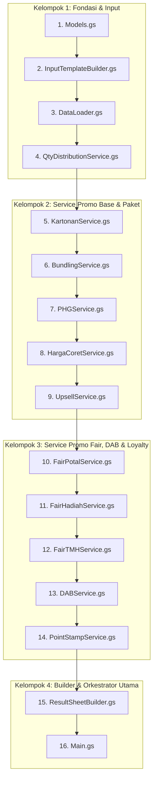

# Rencana Penyempurnaan Per Masing-Masing Script `.gs`

Berikut adalah rencana pengerjaan yang dipecah **1 per 1 untuk setiap berkas `.gs`** (total 16 berkas `.gs` di project Anda) agar output tab `Result - X` 100% selaras dengan **`Result Refference`**.

---

## Urutan Pengerjaan Per Script `.gs`

---

## Detail Tugas Per Masing-Masing Berkas `.gs`

### 1. [Models.gs](file:///c:/Users/Muhammad%20Andreansyah/Documents/Project/Calculate/Models.gs)
- **Fungsi saat ini**: Mendefinisikan [`parseNumber`](file:///c:/Users/Muhammad%20Andreansyah/Documents/Project/Calculate/Models.gs#L11-L28), [`Product`](file:///c:/Users/Muhammad%20Andreansyah/Documents/Project/Calculate/Models.gs#L30-L40), [`PromoRule`](file:///c:/Users/Muhammad%20Andreansyah/Documents/Project/Calculate/Models.gs#L42-L69), [`TransactionItem`](file:///c:/Users/Muhammad%20Andreansyah/Documents/Project/Calculate/Models.gs#L71-L82), dan [`EditOrderRow`](file:///c:/Users/Muhammad%20Andreansyah/Documents/Project/Calculate/Models.gs#L84-L92).
- **Perbaikan yang akan dikerjakan**:
  - Menambahkan helper metode kategori paket pada [`TransactionItem`](file:///c:/Users/Muhammad%20Andreansyah/Documents/Project/Calculate/Models.gs#L71-L82): `isNonPaket()`, `isBundling()`, `isPHG()`, `isFairHadiah()`, `isFairTMH()` agar pengecekan kelayakan item di tiap promo konsisten.
  - Menambahkan helper normalisasi label & urutan kategori promo pada [`PromoRule`](file:///c:/Users/Muhammad%20Andreansyah/Documents/Project/Calculate/Models.gs#L42-L69) serta dukungan pembacaan multi-target item (`getTargetItemList()`).

---

### 2. [InputTemplateBuilder.gs](file:///c:/Users/Muhammad%20Andreansyah/Documents/Project/Calculate/InputTemplateBuilder.gs)
- **Fungsi saat ini**: Membuat template tab `Input` dan `PLU Master`.
- **Perbaikan yang akan dikerjakan**:
  - **Bug Fix di [`generatePluMasterSheet`](file:///c:/Users/Muhammad%20Andreansyah/Documents/Project/Calculate/InputTemplateBuilder.gs#L179-L184)**: Memperbaiki pemanggilan `setFormulas` diikuti `setValues` yang menyebabkan formula kolom `G` (`Harga per pcs`), `H` (`Benefit Rp`), dan `I` (`Benefit %`) terhapus menjadi kosong. Nilai statis kolom `A–F` dan formula kolom `G–I` akan ditulis secara terpisah.
  - **Penyelarasan Data Contoh [`generateInputSheet`](file:///c:/Users/Muhammad%20Andreansyah/Documents/Project/Calculate/InputTemplateBuilder.gs#L37-L75)**: Memastikan `PLU Syarat` untuk `FAIR HADIAH GRATIS` (`PLFFTH02`: `10008825\n20087542`, `PLFFTH05`: `20085988\n10008825`) dan `PHG` (`PLFPHD01`: `10008825\n20087542`, `PLFPHD17`: `10008825\n20087542`) sesuai dengan data di `Input` / `Result Refference`.

---

### 3. [DataLoader.gs](file:///c:/Users/Muhammad%20Andreansyah/Documents/Project/Calculate/DataLoader.gs)
- **Fungsi saat ini**: Membaca dan memvalidasi tab `PLU Master` dan `Input`.
- **Perbaikan yang akan dikerjakan**:
  - Mendukung pembacaan `PLU Syarat` yang ditulis multi-baris di dalam satu sel (dipisahkan newline `\n`) maupun yang ditulis menyamping/ke bawah dalam sub-baris tanpa mengulang `Kode Promo` (seperti format pada `Input` asli).
  - Menyimpan informasi grup header transaksi (`Hadiah`, `Tebus Murah`) bila diperlukan untuk penulisan baris pembatas di tabel Result.

---

### 4. [QtyDistributionService.gs](file:///c:/Users/Muhammad%20Andreansyah/Documents/Project/Calculate/QtyDistributionService.gs)
- **Fungsi saat ini**: Mendistribusikan `Qty Aktual` berdasarkan prioritas paket (`1. Bundling -> 2. Hadiah PHG -> 3. Non-Paket -> 4. Fair Hadiah -> 5. Tebus Murah`) dan membuat ringkasan `EDIT ORDER`.
- **Perbaikan yang akan dikerjakan**:
  - Memastikan urutan PLU pada `buildEditOrderSummary` mengikuti urutan kemunculan PLU di transaksi (`10008095`, `20085988`, `10008825`, `20087542`) persis seperti baris 94–97 di `Result Refference`.

---

### 5. [KartonanService.gs](file:///c:/Users/Muhammad%20Andreansyah/Documents/Project/Calculate/KartonanService.gs)
- **Fungsi saat ini**: Menghasilkan formula `Diskon Karton` dan `Net Sales After Karton`.
- **Perbaikan yang akan dikerjakan**:
  - Menambahkan metode `buildRefundKartonFormula(salesKartonCell, fulfillKartonCell)` untuk konsistensi pemanggilan antar-service pada tabel `REFUND` (`=G{sr}-H{fr}`).

---

### 6. [BundlingService.gs](file:///c:/Users/Muhammad%20Andreansyah/Documents/Project/Calculate/BundlingService.gs)
- **Fungsi saat ini**: Menghasilkan formula diskon paket `Bundling`, prorata `Bundling / PLU`, dan `Net Sales After Bundling`.
- **Perbaikan yang akan dikerjakan**:
  - Memastikan di tabel `FULFILLMENT SALES`: untuk baris `Non-Paket`, formula `Bundling / PLU` merujuk langsung `=J{sr}` (atau `=0`), sedangkan untuk baris `Bundling`, menggunakan `=IFERROR(F{fr}*(J{sr}/E{sr}),0)` persis seperti baris 118–123 di `Result Refference`.

---

### 7. [PHGService.gs](file:///c:/Users/Muhammad%20Andreansyah/Documents/Project/Calculate/PHGService.gs)
- **Fungsi saat ini**: Menghasilkan formula `PHG`, `PHG/PLU`, dan `Net Sales After PHG`.
- **Perbaikan yang akan dikerjakan**:
  - Memperbaiki [`buildFulfillmentPHGFormula`](file:///c:/Users/Muhammad%20Andreansyah/Documents/Project/Calculate/PHGService.gs#L27-L29) agar pada baris item `Hadiah PHG` di tabel `FULFILLMENT SALES` menghasilkan `=G{fr}` (Gross Sales Fulfillment dari hadiah yang terpenuhi stoknya, sehingga jika `Qty Aktual = 0` otomatis menjadi `Rp0`, dan jika terpenuhi sebagian tetap proporsional), sesuai sel `L125:L127` di `Result Refference`.

---

### 8. [HargaCoretService.gs](file:///c:/Users/Muhammad%20Andreansyah/Documents/Project/Calculate/HargaCoretService.gs)
- **Fungsi saat ini**: Menghasilkan formula `Harga Coret` (Rp maupun %), `Harga Coret / PLU`, dan `Nett Sales After Harga Coret`.
- **Perbaikan yang akan dikerjakan**:
  - Memastikan formula `Nett Sales After Harga Coret` pada tabel `FULFILLMENT SALES` dan `REFUND` menggunakan pembungkus `=MAX(0, {netPrev}-{coretPlu})` sesuai kolom `O` di `Result Refference`.
  - Menambahkan metode formula proporsional `=IFERROR(F{fr}*({salesCoretPluCol}{sr}/E{sr}),0)` untuk baris non-eligible di `FULFILLMENT SALES`.

---

### 9. [UpsellService.gs](file:///c:/Users/Muhammad%20Andreansyah/Documents/Project/Calculate/UpsellService.gs)
- **Fungsi saat ini**: Menghasilkan formula `Upsell {Kode}`, `Upsell / PLU`, dan `Net Sales After Upsell` untuk `Campur = N` dan `Campur = Y`.
- **Perbaikan yang akan dikerjakan**:
  - Memperbaiki urutan balancing prorata di [`buildCampurProrateFormula`](file:///c:/Users/Muhammad%20Andreansyah/Documents/Project/Calculate/UpsellService.gs#L36-L41):
    - Di `SALES`: item terakhir menggunakan `={TotalUpsell}-SUM({prevRange})`.
    - Di `FULFILLMENT SALES`: menyesuaikan rumus prorata dan pembungkus `=MAX(0, {netPrev}-{upsellPlu})` pada kolom `Net Sales After Upsell`.
  - Menambahkan metode `buildRefundTotalFormula(salesTotalCell, fulfillTotalCell)` (`={salesTotalCell}-{fulfillTotalCell}`) dan `buildRefundProrateFormula(...)` agar di tabel `REFUND` nilai clawback Upsell terhitung otomatis (bukan `=0`).

---

### 10. [FairPotalService.gs](file:///c:/Users/Muhammad%20Andreansyah/Documents/Project/Calculate/FairPotalService.gs)
- **Fungsi saat ini**: Menghasilkan formula `Fair Potal {Kode}`, `Fair Potal / PLU`, dan `Net Sales After Fair Potal`.
- **Perbaikan yang akan dikerjakan**:
  - Memperbaiki [`buildFulfillmentTotalFormula`](file:///c:/Users/Muhammad%20Andreansyah/Documents/Project/Calculate/FairPotalService.gs#L39-L41) agar menerima parameter referensi sel `maxRpCell` (misal `L36` atau `L38`, bukan angka statis) dan menghitung `=MIN(CEILING((${fulfillmentEligibleSum}/${maxRpCell})*${salesTotalCell},100),${salesTotalCell})`.
  - Menambahkan metode `buildRefundTotalFormula` dan `buildRefundProrateFormula` untuk menghitung selisih dan prorata `Fair Potal` di tabel `REFUND`.

---

### 11. [FairHadiahService.gs](file:///c:/Users/Muhammad%20Andreansyah/Documents/Project/Calculate/FairHadiahService.gs)
- **Fungsi saat ini**: Menghasilkan formula diskon untuk item paket `Fair Hadiah`.
- **Perbaikan yang akan dikerjakan**:
  - Menyelaraskan [`buildFulfillmentFormula`](file:///c:/Users/Muhammad%20Andreansyah/Documents/Project/Calculate/FairHadiahService.gs#L20-L22) agar menggunakan nilai Net Sales sebelumnya pada baris Fair Hadiah (`={lastNetCol}{fr}`, seperti `=AG128` di `Result Refference`) sehingga saat `Qty Aktual = 0` nilainya `Rp0`.

---

### 12. [FairTMHService.gs](file:///c:/Users/Muhammad%20Andreansyah/Documents/Project/Calculate/FairTMHService.gs)
- **Fungsi saat ini**: Menghasilkan formula untuk item paket `Fair Tebus Murah` dan kolom `Fair TMH/PLU`.
- **Perbaikan yang akan dikerjakan**:
  - Memperbaiki [`buildFulfillmentFormula`](file:///c:/Users/Muhammad%20Andreansyah/Documents/Project/Calculate/FairTMHService.gs#L22-L24) agar menggunakan rumus proporsional terhadap Sales (`=IFERROR(F{fr}*({salesTmhPluCol}{sr}/E{sr}),0)`) sesuai sel `AH131:AH132` di `Result Refference`.

---

### 13. [DABService.gs](file:///c:/Users/Muhammad%20Andreansyah/Documents/Project/Calculate/DABService.gs)
- **Fungsi saat ini**: Menghasilkan formula `Diskon Alat Bayar {Kode}`, `Diskon Alat Bayar/PLU`, dan `Net Sales After Diskon Alat Bayar`.
- **Perbaikan yang akan dikerjakan**:
  - Menambahkan logika balancing item pada [`buildSalesProrateFormula`](file:///c:/Users/Muhammad%20Andreansyah/Documents/Project/Calculate/DABService.gs#L22-L24) dan [`buildRefundProrateFormula`](file:///c:/Users/Muhammad%20Andreansyah/Documents/Project/Calculate/DABService.gs#L53-L55) (di mana 1 baris eligible memakai `={TotalDAB}-SUM({baris_lain})`) sehingga jumlah `Diskon Alat Bayar/PLU` pada `SALES`, `FULFILLMENT SALES`, dan `REFUND` selalu bulat 100% sama dengan nilai total DAB-nya (seperti sel `AN73`, `AK114`, dan `AK137` di `Result Refference`).

---

### 14. [PointStampService.gs](file:///c:/Users/Muhammad%20Andreansyah/Documents/Project/Calculate/PointStampService.gs)
- **Fungsi saat ini**: Menghasilkan formula `Point Received` dan `Stamp Received` (Base, Fair, Cart).
- **Perbaikan yang akan dikerjakan**:
  - Menambahkan metode `buildBaseCampurFulfillmentFormula(qtyAktualRange, qtyBeliRange, minQtyCell, maxQtyCell, salesPtCell)` untuk Base Poin/Stamp dengan `Campur = Y` (`HOKA090E` dan `HOKA090L`) pada tabel `FULFILLMENT SALES`.
  - Menyelaraskan formula `buildCartSalesFormula` dan `buildCartFulfillmentFormula` dengan `Result Refference`: `=CEILING(MIN(ROUNDDOWN({netTotalSum}/${minRpCell},0)*${minRpCell},${maxRpCell})/${minRpCell}*${benefitPtCell},1)`.

---

### 15. [ResultSheetBuilder.gs](file:///c:/Users/Muhammad%20Andreansyah/Documents/Project/Calculate/ResultSheetBuilder.gs)
- **Fungsi saat ini**: Menyusun seluruh tabel pada tab `Result - X`.
- **Perbaikan yang akan dikerjakan**:
  1. **Tabel `Tipe Promo` (Baris Atas)**: Memecah setiap `PLU Syarat` pada promo multi-PLU menjadi sub-baris tersendiri di kolom `H` dengan `=IFERROR(VLOOKUP(H{row},'PLU Master'!$B:$C, 2, FALSE),"-")` di kolom `I`.
  2. **Dynamic Column Tracker (`salesColMap`, `fulfillColMap`, `refundColMap`)**: Menghapus semua *hardcoded column letters* (`M`, `X`, `R`, `AD`, `AJ`, `AK`, `AL`, `AM`, `AP`, `AT`, `AB`, `AE`, `AH`) dan menggantinya dengan pembacaan dari map kolom dinamis.
  3. **Filter Baris Eligible di `SALES`, `FULFILLMENT`, dan `REFUND`**: Memastikan `Harga Coret`, `Upsell`, dan `Base Poin/Stamp` hanya dikenakan pada baris `Non-Paket`, sedangkan `Fair Potal` dikenakan pada baris `Non-Paket` + `Bundling` yang sesuai `PLU Syarat`.
  4. **Baris Total Poin & Stamp + `Detail Transaksi` Akhir**: Menambahkan `=SUM(...)` poin & stamp di bawah tabel `FULFILLMENT` & `REFUND`, serta menghubungkan seluruh baris `Detail Transaksi` ke kolom dinamis yang tepat.

---

### 16. [Main.gs](file:///c:/Users/Muhammad%20Andreansyah/Documents/Project/Calculate/Main.gs)
- **Fungsi saat ini**: Menyediakan menu `Simulasi Promo & Refund` dan orkestrasi eksekusi.
- **Perbaikan yang akan dikerjakan**:
  - Memastikan alur integrasi ke-15 script di atas berjalan mulus tanpa konflik variabel global V8 dan memperbarui pengujian menyeluruh.
